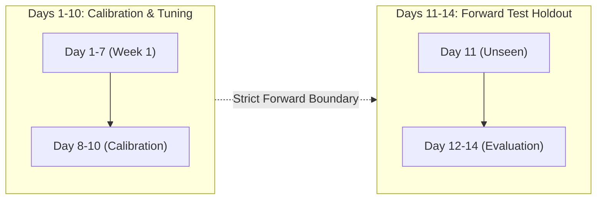

# QueueSense — Statistical Validation & Ground-Truth Protocol

**Document Version:** 1.0.0  
**Effective Date:** 2026-11-24  
**Audit Reference:** P1.17 (Batch 3 Production Hardening)  
**Status:** Canonical Engineering Specification & Scientific Disclosure  

---

## 1. Executive Disclosure: Absence of Physical Sensor Ground Truth

### 1.1 Current Operational Baseline
QueueSense currently relies on crowdsourced student observations submitted via web clients. As of the current production hardening release:

> **CRITICAL SCIENTIFIC DISCLOSURE:**  
> There is currently **zero physical sensor infrastructure** (turnstiles, optical computer vision, LiDAR, BLE beacons, or Wi-Fi probe sniffers) and **zero independently verified ground-truth measurement dataset** deployed in the QueueSense live environment.

### 1.2 Mathematical vs Real-World Validity
Unit tests, deterministic synthetic replays, and adversarial property tests establish that:
1. The mathematical algorithms are internally consistent.
2. The code correctly handles edge cases, zero denominators, clock skews, and data discontinuities.
3. Corroborated rush-hour surges are not discarded by outlier filters.
4. The decay function tapers smoothly without step discontinuities.

However, **internal consistency does not establish empirical real-world accuracy**. A statistical model can pass 100% of synthetic test suites while producing uncalibrated estimates in the physical dining halls. Until the field validation protocol specified in this document is executed and verified against independent physical measurements, **QueueSense explicitly refrains from claiming calibrated predictive accuracy or Bayesian probability calibration**. All confidence metrics are categorized as heuristic composite scores (`HEURISTIC_COMPOSITE`).

---

## 2. Field Observation Collection Protocol

To transition QueueSense from a heuristic crowdsourced model to a calibrated predictive system, field validation data must be systematically collected using the standardized protocol below.

### 2.1 Standardized Observation Schema
Field measurement agents (trained student observers or automated ground-truth logging stations) must record the following schema:

| Field | Type | Description |
|---|---|---|
| `observationId` | String (UUIDv4) | Unique identifier for the measurement record. |
| `locationId` | String | Target campus outlet ID (e.g., `iitb-mess-h12-14`). |
| `timestampUtc` | ISO 8601 String | Observation time in UTC (`YYYY-MM-DDTHH:MM:SSZ`). |
| `measuredWaitMinutes` | Float ($[0.0, 120.0]$) | True elapsed wait time measured via token tracking or stopwatch. |
| `measuredQueueLength` | Integer ($[0, 300]$) | Physical headcount of people in line at timestamp. |
| `measurementMethod` | Enum | `TOKEN_TRACKING`, `STOPWATCH_TRANSIT`, `HEADCOUNT_CENSUS`, or `LITTLES_LAW_DERIVED`. |
| `observerId` | String (Pseudonym) | High-entropy surveyor identifier (e.g., `OBS_7F4A12`); no PII. |
| `operatingStatus` | Enum | `OPEN_NORMAL`, `OPEN_LIMITED_COUNTERS`, `MEAL_RUSH_SPIKE`, `CLOSING`. |
| `activeServiceCounters` | Integer ($[1, 10]$) | Number of functional service/billing counters operating. |
| `measurementUncertainty` | Float | Estimated margin of measurement error in minutes (e.g., $\pm 0.5$ min). |
| `mealPeriod` | Enum | `BREAKFAST`, `LUNCH`, `SNACKS`, `DINNER`, `LATE_NIGHT`. |
| `contextualConditions` | Object | Academic cycle (`EXAM_WEEK`, `REGULAR`), weather conditions (`RAIN`, `CLEAR`). |

### 2.2 Measurement Methodologies

#### Method A: End-to-End Token Transit (Gold Standard for Wait Time)
1. An observer joins the tail of the physical queue at $T_{\text{entry}}$.
2. The observer records the exact headcount in front of them at entry ($L_{\text{entry}}$).
3. The observer moves through the line without purchasing or cutting, reaching the service/billing point at $T_{\text{service}}$.
4. Ground-truth wait time is computed as $W_{\text{true}} = (T_{\text{service}} - T_{\text{entry}})$ in minutes.
5. Measurement uncertainty is limited to stopwatch human reaction time ($\le \pm 0.1$ min).

#### Method B: Headcount Census & Queue Departure Rate (Little's Law Validation)
1. An observer records instantaneous queue headcount $L(t)$ at fixed 5-minute intervals.
2. The observer counts departures (customers served per minute) across a 15-minute window to measure service rate $\mu$.
3. Derived wait time is computed via Little's Law: $W_{\text{derived}} = L(t) / \mu$.
4. Applicable during high-density rush periods where token transit is physically constrained.

### 2.3 Privacy and Data Minimization (DPDP Act & GDPR Alignment)
Under the Indian Digital Personal Data Protection (DPDP) Act 2023 and GDPR:
- Zero personal identifiers of students in line (names, roll numbers, hostel room numbers, facial imagery, or MAC addresses) shall be captured or stored.
- Observer identities must use opaque cryptographic pseudonyms.
- Field logs contain strictly operational queuing variables.

---

## 3. Statistical Evaluation Metrics

Evaluation metrics must be tailored to the asymmetric operational consequences of food queue estimation: underestimating wait time causes missed classes and student frustration, whereas slight overestimation carries lower user regret.

### 3.1 Primary Error Metrics

#### 1. Mean Absolute Error (MAE)
$$\text{MAE} = \frac{1}{N} \sum_{i=1}^N \left| \hat{y}_i - y_i \right|$$
- **Rationale:** Direct, interpretable measure of average error in minutes. Robust and intuitive for campus operations.
- **Target Threshold:** $\text{MAE} \le 3.0$ minutes for off-peak; $\text{MAE} \le 5.0$ minutes during rush-hour peaks.

#### 2. Root Mean Squared Error (RMSE)
$$\text{RMSE} = \sqrt{\frac{1}{N} \sum_{i=1}^N \left( \hat{y}_i - y_i \right)^2}$$
- **Rationale:** Penalizes severe prediction outliers (e.g., predicting 5 minutes when actual queue is 35 minutes). Large errors severely damage student trust.

#### 3. Median Absolute Error (MedAE)
$$\text{MedAE} = \text{median}\left( \left| \hat{y}_1 - y_1 \right|, \dots, \left| \hat{y}_N - y_N \right| \right)$$
- **Rationale:** Non-parametric robust estimator insensitive to rare field observation recording errors.

#### 4. Mean Signed Error (Bias)
$$\text{Bias} = \frac{1}{N} \sum_{i=1}^N \left( \hat{y}_i - y_i \right)$$
- **Rationale:** Detects systematic bias. A positive bias indicates consistent over-prediction; a negative bias indicates systematic under-prediction.
- **Target Threshold:** $|\text{Bias}| \le 1.0$ minute across a full operational cycle.

### 3.2 Metric Exclusions
> [!WARNING]
> **Mean Absolute Percentage Error (MAPE) is explicitly excluded** from the primary metric suite.
> When true wait times are near zero (e.g., 0.5 to 1.5 minutes), a prediction of 3.0 minutes produces a mathematical percentage error of 200% to 500%, despite being operationally negligible ($\Delta = 1.5$ min). MAPE produces catastrophic skew in low-wait regimes.

### 3.3 Stratified Evaluation Matrix
Evaluation results must be reported stratified by:
1. **Queue Density Range:**
   - Low: $0 \le W < 5.0$ min
   - Moderate: $5.0 \le W < 10.0$ min
   - High: $10.0 \le W < 20.0$ min
   - Severe Rush: $W \ge 20.0$ min
2. **Meal Windows:** Breakfast (07:30–09:30), Lunch (12:00–14:15), Snacks (16:30–18:00), Dinner (19:30–21:45).
3. **Outlet Category:** Mess Dining (high batch throughput) vs Canteen/Cafe (on-demand preparation).

---

## 4. Time-Based Validation Methodology

### 4.1 Prohibition of Random Cross-Validation
Standard k-fold cross-validation randomly shuffles observations across time. In queuing systems, this causes **severe temporal data leakage**: an observation at 12:34 PM leaks near-identical queue information to a test point at 12:35 PM.

### 4.2 Time-Based Holdout Strategy
Validation must strictly enforce temporal forward-chaining:
1. **Historical Calibration Window:** Days 1 through 10 (used to tune $\tau$, MAD cutoffs, and volume scaling).
2. **Holdout Evaluation Window:** Days 11 through 14 (completely unseen forward test partition).
3. **Rolling Origin Evaluation:** Predict $t + \Delta t$ strictly using observations available prior to $t$.

### 4.3 Minimum Sample Requirements
Before claiming empirical validation:
- Total Verified Observation Pairs: $N \ge 250$ per campus.
- Outlets Evaluated: Minimum 5 distinct locations across both Mess and Canteen categories.
- Rush-Hour Representation: Minimum 100 observations collected strictly within peak meal rush windows.
- Temporal Span: Minimum 14 continuous operational days covering weekdays and weekends.

---

## 5. Synthetic Robustness vs Real-World Accuracy

To maintain scientific integrity, QueueSense engineering strictly distinguishes between synthetic benchmarking and real-world accuracy:

| Capability Claim | Current Evidence Base | Current Claim Status |
|---|---|---|
| Algorithmic Determinism & Zero Division Safety | 139 automated Pytest unit/integration tests | **VERIFIED IMPLEMENTED** |
| Zero-MAD Stability & Non-Crash Behavior | Property tests covering identical report bursts | **VERIFIED IMPLEMENTED** |
| Corroborated Surge Preservation | Adversarial synthetic test scenarios | **VERIFIED IMPLEMENTED** |
| Smooth Time-Decay Tapering (No Discontinuity) | Mathematical derivation & boundary tests | **VERIFIED IMPLEMENTED** |
| Real-World Wait Time Prediction Accuracy | None (Pending field ground-truth dataset) | **UNVERIFIED — EXPLICITLY UNCLAIMED** |
| Bayesian Probability Calibration of Confidence | None (Pending empirical calibration dataset) | **UNVERIFIED — LABELED HEURISTIC** |

---

## 6. Roadmap to Physical Ground-Truth Integration

When resources permit institutional ground-truth deployment, the following phased integration path will be executed:

1. **Phase A (Student Council Field Audit):** Execute a 14-day manual stopwatch and token tracking campaign following the protocol in Section 2 across 4 selected pilot dining halls.
2. **Phase B (Empirical Parameter Calibration):** Fit decay constant $\tau$ and MAD thresholds to minimize MAE against the empirical field dataset.
3. **Phase C (Automated Turnstile / POS Integration):** Ingest real-time counter transaction velocity from dining hall billing POS terminals (de-identified transaction rate $\lambda$) to dynamically validate queue throughput without manual observers.
4. **Phase D (Published Validation Audit):** Publish verified MAE, RMSE, and bias figures alongside 95% confidence intervals in this protocol document.
